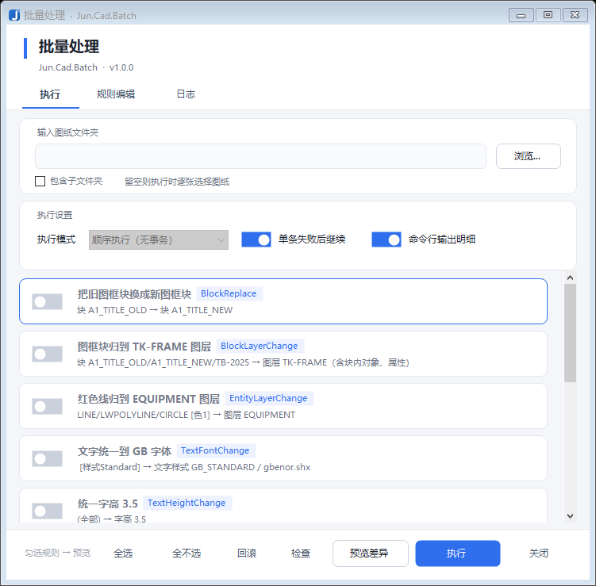
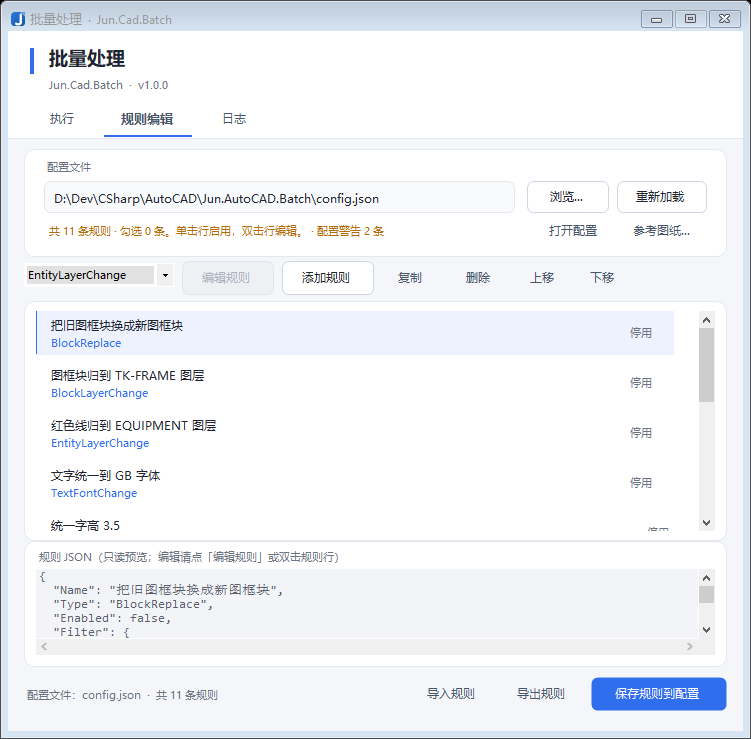

# Jun.Cad.Batch —— 离线批量改图

不打开 AutoCAD，直接读写 `.dwg`，按 `Jun.Cad.Batch.json` 里的规则批量修改图纸。
底层用 [ACadSharp](https://github.com/DomCR/ACadSharp) 3.8.35（MIT）解析 DWG 二进制，
可以跑在服务器、CI、批处理脚本里。

**这是一个批量变换器，不是图纸质检平台、不是绘图工具、也不是 AutoCAD 的替代品。**
它做的事只有一件：按你写的规则，把一批 DWG 的属性改掉、图元增删掉，然后写回文件。

```
Jun.Cad.Batch.Cli run --config Jun.Cad.Batch.json --input D://图纸 --pattern *.dwg
```

---

## 1. 问题、目标与非目标

### 1.1 要解决的问题

出图前的批量归一化——换图层标准、统一字体、换填充图案、给文字加遮罩、改标题栏——
在有 AutoCAD 的机器上是插件活；在没有授权的服务器、CI、图纸归档流水线上，这些事
要么手工做，要么根本不做。本项目把这类"机械但量大的改动"变成一条可重复执行的命令。

### 1.2 目标

1. **不依赖 AutoCAD 进程**：不启动 `acad.exe`、不调用 `accoreconsole`、不用任何宿主反应器；
2. **可重复、可预演**：同一份配置跑两遍结果一致；执行前能逐条看到"会改什么"；
3. **改坏了能退**：默认不覆盖源图，覆盖时留备份，整批可按运行清单回滚。

### 1.3 非目标

| 不做 | 原因 |
|---|---|
| 绘图 / 建模 / 出图 | 这是设计工作，不是批处理 |
| 打印、PDF 导出、打印调度 | ACadSharp 不是渲染库；本项目不含打印通道 |
| 图纸质检平台（审图报告、问题流转） | 只读检查规则是顺带做的（见 6.2），不做报告体系 |
| 替代 AutoCAD 的编辑能力 | 依赖内核求值、交互、事务的能力在这里一律不存在（见 2.1） |
| 跨图纸的块/样式导入 | 目标块必须已存在于被处理图纸的块表里 |
| 文件级并行 | 见 7.5：没做过规模验证，不写没测过的并发 |

---

## 2. 两条硬约束（决定了其余一切）

这份文档的其余部分几乎都能从这两条推出来。先看它们，后面的能力矩阵就不用背了。

### 2.1 没有内核、没有事务

没有 AutoCAD 进程，就没有求值引擎、没有交互选择集、没有事务。
一次处理只能是：

```
读全图 → 在内存里改 → 写全图
```

推论（这些不是"没实现"，是结构上不存在）：

* 没有事务回滚，回滚边界只能是**文件**；
* 没有"当前选择集"，`Scope=Selection` 只能降级为整张图；
* 标注文字位置、表格单元格显示这类**派生对象**，不会因为你改了源数据而自动更新；
* 任何依赖"宿主重生成"的效果都不成立。

### 2.2 只有部分对象被建模，且只能写实体自身属性

ACadSharp 是部分实现：读不出的对象只进 `ReadNotices`，写回时行为未验证（见第 8 节）。
更关键的是**写入面**：能可靠写的是实体自身属性（图层、颜色、文字内容、字高、样式引用……），
而"派生对象一致性"（标注缓存块、表格缓存块、块内几何随参照变换）不在可写范围内。

推论：

* 改标注的显示文字，要动的是它 `*D` 缓存块里的 MText；
* 改表格单元格，缓存块不会跟着变，查看端可能仍显示旧值；
* **新建实体只能追加到实体列表末尾**（`CadObjectCollection` 没有按索引插入），
  所以"把遮罩放到文字下面"要么重建文字（换句柄），要么改用文字自身的属性。

### 2.3 由此推出的三种效果族

任何一条规则，效果只可能是这三类之一：

| 效果族 | 做什么 | 失败语义 | 幂等性 |
|---|---|---|---|
| **改属性** | 改实体/样式的属性，不增删对象 | 单对象失败可跳过 | 多数天然幂等 |
| **增删实体** | 新建或删除图元 | 失败可能留下半成品（见 7.2） | 需显式设计（遮罩会跳过已存在的） |
| **只读检查** | 不改图，只出结论 | 不影响文件 | 幂等 |

两条降级来源也由此而来：**没有内核**（2.1）与**写不进去**（2.2）。
第 8 节的能力矩阵就是按这两条逐项推的。

---

## 3. 快速开始

### 3.1 构建

需要 **.NET 8 SDK**。一条命令构建 CLI 与界面两个工程：

```bash
dotnet build Jun.Cad.Batch.sln -c Release
```

| 产物 | 路径 | 目标框架 |
|---|---|---|
| 命令行 | `src/Jun.Cad.Batch.Cli/bin/Release/net8.0/Jun.Cad.Batch.Cli.exe` | `net8.0`（跨平台，不依赖 Windows 桌面组件） |
| 界面 | `src/Jun.Cad.Batch.Win/bin/Release/net8.0-windows/Jun.Cad.Batch.exe` | `net8.0-windows`（仅 Windows） |

两个 exe 嵌同一份图标 `docs/icons/app.ico`（7 个尺寸，小尺寸单独光栅化，不是缩放）。
注意**光配 `ApplicationIcon` 不够**：它只写 exe 的 Win32 资源，窗口类注册时 `hIcon` 仍是 NULL，
标题栏与任务栏会退回系统默认图标。界面工程另把 `.ico` 作为 `EmbeddedResource` 嵌入、
运行时读出来设给 `Form.Icon`（见 `AppInfo.AppIcon`）。

#### 单文件发布（界面工程）

```bash
# 框架依赖版：一个 2.8 MB 的 exe，目标机需装 .NET 8 Desktop Runtime
dotnet publish src/Jun.Cad.Batch.Win -p:PublishProfile=single-file

# 自包含版：一个 73 MB 的 exe，目标机什么都不用装
dotnet publish src/Jun.Cad.Batch.Win -p:PublishProfile=single-file-selfcontained
```

| 版本 | 单文件大小 | 依赖 | 产物 |
|---|---|---|---|
| `single-file` | **2.8 MB** | .NET 8 Desktop Runtime (x64) | `bin/publish/single-file/Jun.Cad.Batch.exe` |
| `single-file-selfcontained` | **72.6 MB** | 无 | `bin/publish/single-file-sc/Jun.Cad.Batch.exe` |

两个都实测过：启动正常、`--check-taskbar` 通过、`--run` 跑完整批处理（7 处改动 0 失败，
图案库正常加载）。启动耗时 ~430 ms（多文件版 ~410 ms，解压已缓存时）。

四个**必须**的开关（都写在 `.pubxml` 里了，别删）：

| 开关 | 不加会怎样 |
|---|---|
| `IncludeAllContentForSelfExtract` | `Resources/` 下的 `.pat/.lin` 是内容文件，不加就只打包程序集，资源仍散落在 exe 旁边——"单文件"名不副实。加上后启动时解压到 `%TEMP%\.net\Jun.Cad.Batch\<hash>\`（约 10 MB），`AppContext.BaseDirectory` 指向那里，现有的"按目录找 acadiso.pat"逻辑**不用改一行代码** |
| `IncludeNativeLibrariesForSelfExtract` | 自包含版会甩出 5 个 WPF 原生 dll（`D3DCompiler_47_cor3.dll`、`wpfgfx_cor3.dll` 等） |
| `DebugType=None` + `CopyOutputSymbolsToPublishDirectory=false` | 多出 `.pdb` |
| 发布后删除 `*.pdb`（`RemoveSymbolsFromPublish` target） | 被引用工程（Core）的 `.pdb` 仍会跟进发布目录，前面两项在部分 SDK 组合下挡不住 |

**不要用 `PublishTrimmed`**：WinForms 不支持裁剪，SDK 会直接报错。自包含版 72 MB 里大头是
Windows Desktop 运行时（含 WPF 原生库），已经开了 `EnableCompressionInSingleFile`（从 ~150 MB 压到 72 MB）。

命令行工程同理，把项目路径换成 `src/Jun.Cad.Batch.Cli`、`RuntimeIdentifier` 按目标平台选即可。

### 3.2 准备图案库（只在用 `HatchPatternChange` 时需要）

离线工具没有内核，换图案必须自带图案定义。把 AutoCAD 的图案库复制到**程序目录**的 `Resources` 下：

```bat
mkdir <程序目录>\Resources
copy "C://Program Files//Autodesk//AutoCAD 2025//UserDataCache//zh-cn//Support//acadiso.pat" <程序目录>\Resources\
copy "C://Program Files//Autodesk//AutoCAD 2025//UserDataCache//zh-cn//Support//acadiso.lin" <程序目录>\Resources\
```

> CLI 与界面是两个不同目录（见 3.1），两边各放一份，或统一用 `--pat` / `--lin` 指定。

查找顺序：`--pat`/`--lin` → `Resources\acadiso.pat` → `Resources\acad.pat` → 程序目录 →
本机已安装的 AutoCAD（仅开发机便利，生产环境不要依赖）。

仓库的 `Resources` 下**两份 `.pat` 都带了**：

| 文件 | 作用 |
|---|---|
| `acadiso.pat` | 主图案库（公制/ISO/JIS）。`HatchPatternChange` 的图案定义全部从这里取 |
| `acad.pat` | 只用来判断"这个名字在英制图纸里认不认得"。**决定要不要改 `$MEASUREMENT`**（见 5 顶层字段） |

**每次 `run` 都会打印实际加载的 `.pat` 绝对路径**——不同 AutoCAD 版本的图案库内容不同，
不打印的话，同一份配置在两台机器上可以产出不同的图案几何。

### 3.3 跑一次

```bash
# 看会改什么，不写盘
Jun.Cad.Batch.Cli run --config samples\hatch-jis_LC_8A.json --input 图纸.dwg --preview

# 写到 <输入目录>\output
Jun.Cad.Batch.Cli run --config samples\hatch-jis_LC_8A.json --input 图纸目录 --pattern *.dwg

# 覆盖源文件（自动生成 .bak）
Jun.Cad.Batch.Cli run --config Jun.Cad.Batch.json --input 图纸.dwg --in-place
```

不想敲命令就用界面：`Jun.Cad.Batch.exe`，勾规则 → 检查 → 预览 → 执行，见第 11 节。

### 3.4 配置文件从哪来

程序**默认只认 exe 同目录**的 `Jun.Cad.Batch.json`（命令行与界面一样）：

| 情况 | 行为 |
|---|---|
| 文件存在 | 直接加载 |
| 文件不存在 | 按**内置模板**生成一份：20 种规则各一条示例，**全部 `Enabled: false`** |
| 想用别的文件 | `--config <路径>`（命令行）/ 「浏览…」（界面） |

模板嵌在程序里（`Jun.Cad.Batch.Core` 的 `EmbeddedResource`），不是随包发的文件——
删了、改坏了，下次启动会自己长回来。唯一真源是仓库根的 `Jun.Cad.Batch.json`，改那一份即可。

> 早先版本会在"程序目录 → 当前工作目录"两处找 `config.json`。现在**不再看当前工作目录**：
> 路径只有一个来源，就不会出现"我明明改了配置却没生效"（改的是另一份）。
> 另外单文件发布时 `AppContext.BaseDirectory` 指向 `%TEMP%` 的解压目录，
> 所以这里用 `Environment.ProcessPath` 取真正双击的那个 exe 所在目录。

---

## 4. 命令参考

| 命令 | 作用 |
|---|---|
| `run` | 按配置处理一批 DWG |
| `inspect <文件>` | 只报告版本、表项数量、实体类型分布、填充图案（含实际线距）、块参照分布 |
| `patterns [<acadiso.pat>]` | 列出图案库文件与可用图案名 |
| `preflight [--table-sample <dwg>]` | 前置检查：Wipeout 写出、表格单元格、标注遮罩三项能力探测 |
| `rollback <运行目录>\|--latest <输出目录> [--dry-run]` | 按运行清单回滚某一次运行 |
| `schema [--out <path>] [--markdown]` | 导出配置契约（JSON schema / Markdown 字段表） |
| `types` | 列出已注册的规则类型 |

### `run` 选项

| 选项 | 说明 |
|---|---|
| `--config <path>` | 配置文件。省略时用 **exe 同目录** 的 `Jun.Cad.Batch.json`；文件不存在就按内置模板自动生成一份（20 种规则各一条示例，全部关闭） |
| `--input <path>` | DWG 文件或目录（也可作为第一个位置参数） |
| `--out <dir>` | 输出目录，默认 `<输入目录>\output`。若与源文件同路径，自动改名为 `<名>_out.dwg` |
| `--in-place` | 覆盖源文件；默认**不覆盖**。与 `--out` 互斥，**必须保留备份** |
| `--no-backup` | 仅对非 `--in-place` 的写出有效；与 `--in-place` 同用会被拒绝 |
| `--dry-run` | 跑完整流程但不写盘（只出日志与统计） |
| `--preview` | 差异预览：逐条列出 文件/空间/句柄/旧值→新值/状态，不写盘 |
| `--preview-out <path>` | 预览报告路径（默认 `<输出目录>\preview-时间.md`） |
| `--no-manifest` | 不写运行清单（默认写，用于 `rollback`） |
| `--skip-unchanged` | 一条规则都没改动时不写出文件 |
| `--version <ver>` | 输出版本：接受 `AC1032`、`R2018`、`2018` 三种写法；不在可安全写出集合内时提升到 AC1032 |
| `--pattern <glob>` | 文件匹配，默认 `*.dwg`，可重复 |
| `--recursive` | 递归子目录。输出统一落在 `<输入目录>\output`（不按每个文件自己的目录算）；不同子目录下的同名文件保留子目录结构（`out\A\1.dwg`、`out\B\1.dwg`），不会互相覆盖 |
| `--pat` / `--lin` | 指定图案库 / 线型库 |
| `--log <path>` / `--no-log` | 日志路径 / 不写日志 |
| `--quiet` | 明细只写日志文件，控制台只出统计 |

退出码：`0` 全部成功；`1` 有文件失败（含"规则中止未写盘"）；`2` 参数或配置错误。
未列出的非零码视为内部错误，不要据此分支。

---

## 5. 配置契约

**这一节的表格由 `Jun.Cad.Batch.Cli schema --markdown` 生成，不是手抄的。**
字段标注（`RuleField`）是唯一真源：界面控件、schema 导出、这张表都读同一份标注，
所以它们不会互相漂移。改了标注重新生成即可：

```bash
Jun.Cad.Batch.Cli schema --markdown > /tmp/fields.md
Jun.Cad.Batch.Cli schema --out schema.json      # 机器可读版，给 CI / 编辑器用
```

规则的结构是：

```jsonc
{
  "Version": 1,
  "OnRuleFailure": "DiscardFile",
  "Rules": [
    {
      "Name": "规则名（日志里显示）",
      "Type": "TextReplace",
      "Enabled": true,
      "Filter": { /* 选中什么 */ },
      "Action": { /* 改成什么 */ }
    }
  ]
}
```

`Filter` 与 `Action` 都是**嵌套对象**；模型不认识的字段会被原样接住并写回（`JsonExtensionData`），
不会静默丢失——但也意味着**拼错的键不会报错**（见 9.4）。

### 顶层字段

| 字段 | 类型 | 默认值 |
|---|---|---|
| `Version` | int | `1` |
| `ExecutionMode` | string | `Sequential` |
| `ContinueOnError` | bool | `True` |
| `LogFile` | string | — |
| `Verbose` | bool | `True` |
| `MaxEditorDetailLines` | int | `100` |
| `OnRuleFailure` | string | — |
| `MeasurementUnits` | string | — |

`MeasurementUnits` 对应图形的 `$MEASUREMENT`，决定 AutoCAD 按哪份图案库解析填充图案名：
`0` = `acad.pat`（英制）、`1` = `acadiso.pat`（公制）。

- `Auto`（留空即此值）：**只有**写进图的图案名在 `acad.pat` 里不存在时才改成公制。
  典型是 JIS 系列（`JIS_LC_8A`、`JIS_LC_20`、`JIS_RC_15` …），它们只存在于 `acadiso.pat`。
- `Keep`：不改，但会在日志里告警说明后果。
- `Metric` / `English`：强制。

不改的后果是**填充画得出来、但属性面板的预定义图案列表里没有这个名字**
（AutoCAD 实测：`$MEASUREMENT=0` 时 `(setvar "HPNAME" "JIS_LC_8A")` 直接报"无效的图案名称"）。
只影响图案/线型库的选择，不动 `INSUNITS`，也不动任何已有实体的几何。

### 通用过滤字段（对所有规则生效）

| 字段 | 标签 | 类型 | 可选值 / 单位 | 说明 |
|---|---|---|---|---|
| `EntityTypes` | 实体类型 | TagList | — | DXF 类型名，如 LINE / LWPOLYLINE / TEXT；留空表示不限类型 |
| `ColorIndex` | 颜色索引 | Integer | ACI 索引 | 1=红 2=黄 3=绿 4=青 5=蓝 6=洋红 7=白/黑 256=随层 0=随块 |
| `ColorIndexes` | 颜色索引（多个） | TagList | — | 与单个颜色取并集，可写 1,3,5 这样组合 |
| `TrueColor` | 真彩色 | Text | — | #RRGGBB；只能用遍历判定，Scope=Selection 时不生效 |
| `LayerName` | 图层 | Text | — | 匹配实体自身图层，不做随层解析 |
| `LayerNames` | 图层（多个） | TagList | — |  |
| `Scope` | 扫描范围 | Enum | ModelAndLayouts=模型+全部布局<br>ModelOnly=仅模型<br>LayoutsOnly=仅布局 | 留空等价于模型+全部布局 |
| `LayoutPatterns` | 布局名模式 | TagList | — | 通配符 * ?；留空=全部布局。列了模式就只处理匹配的布局（模型空间要写 Model 或 * 才保留） |
| `ContainerBlockPattern` | 图框块名模式 | Text | — | 通配符；填了只处理落在这些图框块参照包围盒内的对象。留空=不限 |
| `ContainerAttributeTag` | 图框属性 Tag | Text | — | 只处理该属性值匹配的图框；与下一项配对使用 |
| `ContainerAttributePattern` | 图框属性值模式 | Text | — | 通配符；留空表示只要属性存在即可 |
| `RegionMode` | 区域形状 | Enum | None=不限<br>Rect=矩形<br>Polygon=多边形 | 矩形取前两个点；多边形至少三个点。与图框条件同时存在时取交集 |
| `RegionPoints` | 区域顶点 | TagList | — | 每项写 x,y（如 0,0 与 10000,5000）。矩形写两点，多边形至少三点 |
| `RegionPredicate` | 区域判定 | Enum | CenterInside=中心点在区域内<br>FullyInside=完全包含<br>Intersects=部分相交 | 默认中心点；包络盒都是近似的，边界上会有误差 |
| `RegionIncludesNested` | 区域过滤含块内实体 | Toggle | — | 默认否：块内实体是块坐标，没有累计变换，按世界坐标判定会错位 |
| `IncludeNestedBlocks` | 递归块定义内部 | Toggle | — | 默认是；关掉后不进入任何块定义，只处理顶层实体 |
| `MaxNestingDepth` | 最大嵌套深度 | Integer | — | 默认 8，防止异常图纸导致递归过深 |
| `SkipLockedLayers` | 跳过锁定图层 | Toggle | — | 默认是 |

### 各规则专属字段

通用过滤字段不再重复列出；表里只有该类型**专属**的过滤条件与参数。

#### `AttributeAudit`

过滤条件：无专属字段（用上面的通用过滤字段）。

| 参数 | 标签 | 类型 | 可选值 / 单位 | 说明 |
|---|---|---|---|---|
| `RequiredAttributeTags` | 必填属性 Tag | TagList | — | 逐个块参照检查这些 Tag 是否存在且非空 |
| `AttributeAuditFillDefaults` | 按默认值填充 | Toggle | — | 默认否：只报告不写。打开后按下一项的默认值填空 |
| `AttributeDefaults` | 属性默认值 | Text | — | TAG=值;TAG2=值2（只在「按默认值填充」打开时使用） |

#### `BlockLayerChange`

| 专属过滤字段 | 标签 | 类型 | 可选值 / 单位 | 说明 |
|---|---|---|---|---|
| `SourceBlockName` | 源块名 | Text | — | 动态块按有效块名匹配 |
| `SourceBlockNames` | 源块名（多个） | TagList | — | 一次归并好几种块；只写 1 项时会写回 SourceBlockName |

| 参数 | 标签 | 类型 | 可选值 / 单位 | 说明 |
|---|---|---|---|---|
| `AlsoMoveAttributes` | 属性一并归层 | Toggle | — | 不写时跟随「块内对象一并归层」；显式关闭则属性留在原图层 |
| `AlsoMoveBlockContent` | 块内对象一并归层 | Toggle | — | 默认是：块定义里的实体（含嵌套块、属性定义）一起改到目标图层；关掉只挪块参照本身 |
| `TargetLayer` | 目标图层 | Text | — | 不存在时按下面的颜色/线型/线宽自动创建 |
| `CreateIfMissing` | 图层不存在时自动创建 | Toggle | — | 默认是 |
| `LayerColorIndex` | 新建图层颜色 | Integer | — | 默认 7 |
| `LayerLinetype` | 新建图层线型 | Text | — | 缺失时会尝试从 acad.lin / acadiso.lin 加载 |
| `LayerLineWeight` | 新建图层线宽 | Enum | 0=0.00mm<br>5=0.05mm<br>9=0.09mm<br>13=0.13mm<br>15=0.15mm<br>18=0.18mm<br>20=0.20mm<br>25=0.25mm<br>30=0.30mm<br>35=0.35mm<br>40=0.40mm<br>50=0.50mm<br>53=0.53mm<br>60=0.60mm<br>70=0.70mm<br>80=0.80mm<br>90=0.90mm<br>100=1.00mm<br>106=1.06mm<br>120=1.20mm<br>140=1.40mm<br>158=1.58mm<br>200=2.00mm<br>211=2.11mm | 只能选 AutoCAD 支持的线宽（图层不能用随层/随块）；不设置则沿用 AutoCAD 默认 |
| `LayerPlottable` | 新建图层可打印 | Toggle | — | 默认是；设为否后该图层上的对象不打印。只影响自动创建的新图层 |

#### `BlockReplace`

| 专属过滤字段 | 标签 | 类型 | 可选值 / 单位 | 说明 |
|---|---|---|---|---|
| `SourceBlockName` | 源块名 | Text | — | 动态块按有效块名匹配 |

| 参数 | 标签 | 类型 | 可选值 / 单位 | 说明 |
|---|---|---|---|---|
| `TargetBlockName` | 目标块名 | Text | — | 目标块必须已存在于当前图纸块表，插件不会跨图导入 |
| `AllowDynamicBlock` | 允许替换动态块 | Toggle | — | 默认否；关着时遇到动态块直接跳过并记警告 |
| `MigrateAttributes` | 迁移属性值 | Toggle | — | 按 Tag 名称把源块属性值搬到目标块 |

#### `BomSync`

过滤条件：无专属字段（用上面的通用过滤字段）。

| 参数 | 标签 | 类型 | 可选值 / 单位 | 说明 |
|---|---|---|---|---|
| `BomColumnTags` | 材料表列 Tag | TagList | — | 按顺序导出为列；第一项当主键做比对 |
| `BomExportPath` | 导出 CSV | Text | — | 留空则只做比对不导出 |
| `BomComparePath` | 比对基准 CSV | Text | — | 留空则只导出，不比对 |

#### `DimensionStyleChange`

| 专属过滤字段 | 标签 | 类型 | 可选值 / 单位 | 说明 |
|---|---|---|---|---|
| `DimensionStyleName` | 当前标注样式 | Text | — |  |

| 参数 | 标签 | 类型 | 可选值 / 单位 | 说明 |
|---|---|---|---|---|
| `TargetDimensionStyle` | 目标标注样式 | Text | — | 不存在时以 Standard 为模板创建 |
| `ArrowSize` | 箭头大小 | Double | — | 写入 Dimasz |
| `TextHeight` | 标注文字高度 | Double | — | 写入 Dimtxt |

#### `DimTextAudit`

过滤条件：无专属字段（用上面的通用过滤字段）。

| 参数 | 标签 | 类型 | 可选值 / 单位 | 说明 |
|---|---|---|---|---|
| `AuditTolerance` | 绝对容差 | Double | — | 文字数值与测量值之差超过它就算不一致，默认 0.5 |
| `AuditTolerancePercent` | 相对容差 | Double | % | 按测量值的百分比算容差，与绝对容差取较大者 |
| `AuditIncludeEmptyText` | 报告未覆盖文字 | Toggle | — | 默认否：Text 为空或 "<>" 的标注是跟随测量值，属正常 |

#### `EntityLayerChange`

过滤条件：无专属字段（用上面的通用过滤字段）。

| 参数 | 标签 | 类型 | 可选值 / 单位 | 说明 |
|---|---|---|---|---|
| `TargetLayer` | 目标图层 | Text | — | 不存在时按下面的颜色/线型/线宽自动创建 |
| `CreateIfMissing` | 图层不存在时自动创建 | Toggle | — | 默认是 |
| `LayerColorIndex` | 新建图层颜色 | Integer | — | 默认 7 |
| `LayerLinetype` | 新建图层线型 | Text | — | 缺失时会尝试从 acad.lin / acadiso.lin 加载 |
| `LayerLineWeight` | 新建图层线宽 | Enum | 0=0.00mm<br>5=0.05mm<br>9=0.09mm<br>13=0.13mm<br>15=0.15mm<br>18=0.18mm<br>20=0.20mm<br>25=0.25mm<br>30=0.30mm<br>35=0.35mm<br>40=0.40mm<br>50=0.50mm<br>53=0.53mm<br>60=0.60mm<br>70=0.70mm<br>80=0.80mm<br>90=0.90mm<br>100=1.00mm<br>106=1.06mm<br>120=1.20mm<br>140=1.40mm<br>158=1.58mm<br>200=2.00mm<br>211=2.11mm | 只能选 AutoCAD 支持的线宽（图层不能用随层/随块）；不设置则沿用 AutoCAD 默认 |
| `LayerPlottable` | 新建图层可打印 | Toggle | — | 默认是；设为否后该图层上的对象不打印。只影响自动创建的新图层 |

#### `EntityLinetypeChange`

过滤条件：无专属字段（用上面的通用过滤字段）。

| 参数 | 标签 | 类型 | 可选值 / 单位 | 说明 |
|---|---|---|---|---|
| `LinetypeName` | 目标线型 | Text | — | 也可以写 ByLayer / ByBlock |
| `ForceByLayer` | 强制随层 | Toggle | — | 打开后忽略上面的线型/线宽设置 |

#### `EntityLineweightChange`

过滤条件：无专属字段（用上面的通用过滤字段）。

| 参数 | 标签 | 类型 | 可选值 / 单位 | 说明 |
|---|---|---|---|---|
| `ForceByLayer` | 强制随层 | Toggle | — | 打开后忽略上面的线型/线宽设置 |
| `LineWeight` | 目标线宽 | Enum | -1=随层 (ByLayer)<br>-2=随块 (ByBlock)<br>-3=默认 (Default)<br>0=0.00mm<br>5=0.05mm<br>9=0.09mm<br>13=0.13mm<br>15=0.15mm<br>18=0.18mm<br>20=0.20mm<br>25=0.25mm<br>30=0.30mm<br>35=0.35mm<br>40=0.40mm<br>50=0.50mm<br>53=0.53mm<br>60=0.60mm<br>70=0.70mm<br>80=0.80mm<br>90=0.90mm<br>100=1.00mm<br>106=1.06mm<br>120=1.20mm<br>140=1.40mm<br>158=1.58mm<br>200=2.00mm<br>211=2.11mm | 只能选 AutoCAD 支持的线宽；随层/随块/默认也可选 |

#### `GeometryCleanup`

过滤条件：无专属字段（用上面的通用过滤字段）。

| 参数 | 标签 | 类型 | 可选值 / 单位 | 说明 |
|---|---|---|---|---|
| `CleanZeroLength` | 清理零长度线 | Toggle | — | 默认是：长度小于容差的 LINE |
| `ZeroLengthTolerance` | 零长度容差 | Double | 图纸单位 | 默认 0.001 |
| `CleanEmptyText` | 清理空文字 | Toggle | — | 默认是：TEXT/MTEXT 去掉格式码后为空 |
| `CleanDuplicateEntities` | 清理重复实体 | Toggle | — | 默认否：同层同类型且包围盒一致的实体只留一个 |
| `DuplicateTolerance` | 重复容差 | Double | 图纸单位 |  |
| `CleanupDryRun` | 只预演 | Toggle | — | 默认是：只报告会删哪些，不真删。确认无误后关掉 |

#### `HatchPatternChange`

| 专属过滤字段 | 标签 | 类型 | 可选值 / 单位 | 说明 |
|---|---|---|---|---|
| `SourcePatternName` | 源图案 | Text | — | 只改这种图案的填充；留空则改所有 HATCH |
| `SourcePatternNames` | 源图案（多个） | TagList | — |  |

| 参数 | 标签 | 类型 | 可选值 / 单位 | 说明 |
|---|---|---|---|---|
| `TargetPatternName` | 目标图案 | Text | — | 必须已在 acad.pat / acadiso.pat 中定义；SOLID 表示纯色填充 |
| `TargetGradientName` | 目标渐变 | Text | — | 填了就转成渐变填充，优先于目标图案 |
| `PatternType` | 图案类型 | Enum | PreDefined=预定义<br>UserDefined=用户自定义<br>CustomDefined=自定义 | 默认 PreDefined |
| `GradientType` | 渐变类型 | Enum | PreDefinedGradient=预定义渐变<br>UserDefinedGradient=用户自定义渐变 |  |
| `PatternScale` | 图案比例 | Double | — | 绝对值，不做相对缩放；填了就以它为准，不再保持线距 |
| `MatchSpacing` | 保持线距 | Toggle | — | 默认开：按新图案的基准线距反算比例，替换后疏密不变。填了「图案比例」时以比例为准。**关掉 = 沿用原比例**，线距会变成"原比例 × 新图案基准线距"（会告警，见下）。**源是纯色/渐变时没有线距可比，比例取 1.0**（图案原始疏密） |
| `PatternAngle` | 图案角度 | Double | 度 |  |
| `PatternSpace` | 线间距 | Double | — | 仅用户自定义图案有效 |
| `PatternDouble` | 双线 | Toggle | — | 仅用户自定义图案有效 |
| `HatchStyle` | 填充样式 | Enum | Normal=普通<br>Outer=外部<br>Ignore=忽略 |  |
| `GradientAngle` | 渐变角度 | Double | 度 |  |
| `GradientShift` | 渐变偏移 | Double | 0~1 |  |
| `GradientOneColorMode` | 单色渐变 | Toggle | — |  |

#### `HatchPatternChange`：比例是反算出来的，不是配错

「比例」和「线距」在换图案时**不能同时保持**——各图案在 `.pat` 里的基准线距本来就不同：

| 图案 | 基准线距 | 源线距 3 时该用的比例 |
|---|---|---|
| `ANSI31` / `ANSI37` | 3.175 | 0.9449 |
| `JIS_LC_8A` | 7.8 | **0.3846** |
| `JIS_RC_20` | 20 | 0.15 |

所以把 `2_SECONDARY_ESCAPE_ROUTE`（线距 3）换成 `JIS_LC_8A` 时，比例必然是 `3 ÷ 7.8 = 0.384615`，
日志里会打一行：

```
保持线距：原线距 3 ÷ 新图案基准线距 7.8 = 比例 0.384615（替换后线距仍是 3；这个比例是反算出来的，不是配错）
```

这是 **AutoCAD 记录"用哪个比例画出来的"的正确方式**：组码 41 是 0.384615、组码 45/46 是
已缩放的偏移向量（垂距 3）。改成 1 而把缩放进图案线里，属性面板会显示 1，但以后在 CAD 里
手动改比例会跳变（改 2 会变成 15.6 而不是 6）——那是**假装**比例没变。

真要"比例固定为 1"，把 `MatchSpacing` 关掉并写 `PatternScale: 1.0`，代价是线距从 3 变成 7.8。

另外**双线图案**（`JIS_LC_8A`、`2_SECONDARY_ESCAPE_ROUTE` 这类）还有一个独立量：**缝宽**。
线距对齐后缝宽只能跟着比例一起缩（`JIS_LC_8A` 的缝/距比 1:11、`2_SECONDARY_ESCAPE_ROUTE` 是 1:6），
所以 `0.5 → 0.272`。这不是算错，日志里会单独提示一次。

#### 关掉「保持线距」会怎样（踩过一次）

`MatchSpacing: false` 的语义是**沿用原比例**，于是线距 = 原比例 × 新图案基准线距：

| 源 | 原比例 | 原线距 | 关掉后 | 结果 |
|---|---|---|---|---|
| `2_SECONDARY_ESCAPE_ROUTE` | 1 | 3 | `1 × 7.8` | **3 → 7.8（疏 2.6 倍）** |
| 同上（`30210` 那几张） | 75 | 225 | `75 × 7.8` | 225 → 585（疏 2.6 倍） |

这曾经是**静默**的：图上变稀、日志里一个字都没有，只能怀疑工具算错。
现在会打一条 `Warn`，并且把比例真正写回 `PatternScale`——早期版本只是"不碰比例"，
结果出现"组码 `41` 说 75、图案线却是 7.8"的自相矛盾状态，实际线距 7.8（密 29 倍）。

**要线距不变，把该字段设为「是」或直接删掉**（删掉就是默认开）。
界面里这一项是三态：`不设置 / 是 / 否`，选「不设置」才等于用默认值。

#### `LayerMap`

过滤条件：无专属字段（用上面的通用过滤字段）。

| 参数 | 标签 | 类型 | 可选值 / 单位 | 说明 |
|---|---|---|---|---|
| `LayerMappings` | 图层映射 | TagList | — | 写法：0-PIPE*=PIPE（旧名支持 * ?）；多条各占一项 |
| `LayerMapDeleteEmpty` | 删除空源层 | Toggle | — | 默认否：只并层不删层。打开后只删并完之后真的没人用的源层 |

#### `LayoutRename`

过滤条件：无专属字段（用上面的通用过滤字段）。

| 参数 | 标签 | 类型 | 可选值 / 单位 | 说明 |
|---|---|---|---|---|
| `LayoutRenameMap` | 布局改名映射 | TagList | — | 旧名模式=新名；新名可用 {name} 原名、{n} 两位序号，例如 V-{n} |
| `LayoutRenameSyncTag` | 同步到图框属性 | Text | — | 填属性 Tag（如 TITLE）；留空则只改布局名 |

#### `PurgeUnused`

过滤条件：无专属字段（用上面的通用过滤字段）。

| 参数 | 标签 | 类型 | 可选值 / 单位 | 说明 |
|---|---|---|---|---|
| `PurgeCategories` | 清理类别 | MultiEnum | Block=块<br>Layer=图层<br>Linetype=线型<br>TextStyle=文字样式<br>DimStyle=标注样式 | 留空表示全部类别 |
| `PurgePasses` | 迭代轮次 | Integer | — | 处理块删掉后图层才空出来这类链式依赖，默认 3 |

#### `SetByLayer`

过滤条件：无专属字段（用上面的通用过滤字段）。

| 参数 | 标签 | 类型 | 可选值 / 单位 | 说明 |
|---|---|---|---|---|
| `ForceColorByLayer` | 颜色随层 | Toggle | — | 默认是 |
| `ForceLinetypeByLayer` | 线型随层 | Toggle | — | 默认是 |
| `ForceLineWeightByLayer` | 线宽随层 | Toggle | — | 默认是 |
| `ForcePlotStyleByLayer` | 打印样式随层 | Toggle | — | 默认是 |

#### `TextFontChange`

| 专属过滤字段 | 标签 | 类型 | 可选值 / 单位 | 说明 |
|---|---|---|---|---|
| `TextStyleName` | 当前文字样式 | Text | — | 只处理使用该样式的文字 |

| 参数 | 标签 | 类型 | 可选值 / 单位 | 说明 |
|---|---|---|---|---|
| `TargetTextStyle` | 目标文字样式 | Text | — | 不存在时自动创建 |
| `FontFileName` | 字体文件 | Text | — | gbenor.shx 这类 SHX，或 Arial 这类 TrueType |
| `BigFont` | 大字体 | Text | — | 仅 SHX 有效，例如 gbcbig.shx |
| `WidthFactor` | 宽度因子 | Double | — |  |
| `ObliqueAngle` | 倾斜角 | Double | 度 |  |
| `TextStyleHeight` | 样式固定字高 | Double | 0 = 可变 |  |
| `HandleMTextInlineFont` | 解析 MText 内联字体 | Toggle | — | 处理内容里的内联字体码（反斜杠 F） |
| `AlsoUpdateDimensionStyle` | 同步标注样式 | Toggle | — | 标注文字由标注样式控制，这里一并改过去 |

#### `TextHeightChange`

过滤条件：无专属字段（用上面的通用过滤字段）。

| 参数 | 标签 | 类型 | 可选值 / 单位 | 说明 |
|---|---|---|---|---|
| `AlsoUpdateDimensionStyle` | 同步标注样式 | Toggle | — | 标注文字由标注样式控制，这里一并改过去 |
| `Height` | 统一字高 | Double | — |  |
| `LineSpacingFactor` | MText 行距系数 | Double | 0.25~4.0 |  |

#### `TextMask`

过滤条件：无专属字段（用上面的通用过滤字段）。

| 参数 | 标签 | 类型 | 可选值 / 单位 | 说明 |
|---|---|---|---|---|
| `MaskMode` | 遮罩方式 | Enum | Auto=自动（优先 Wipeout）<br>Wipeout=仅 Wipeout<br>Solid=仅 2D Solid | 只影响 TEXT/ATTRIB 的新建遮罩；MTEXT 走原生背景遮罩。Auto：探测失败自动降级 Solid |
| `MaskPaddingRatio` | 留白比例 | Double | × 字高 | 默认 0.15 |
| `MaskPadding` | 留白（绝对） | Double | 图纸单位 |  |
| `MaskOnlyWhenOccluded` | 仅在有遮挡时添加 | Toggle | — | 默认是：先判断文字矩形被压住多少，再决定加不加 |
| `MaskMinOccludedRatio` | 遮挡阈值 | Double | 0~1 | 文字矩形被压住的面积占比达到该值才算遮挡，默认 0.05 |
| `MaskIgnoreBlockBounds` | 忽略块参照包络 | Toggle | — | 默认是（忽略）：块参照包络往往远大于实际图形，用它判遮挡会大面积误判 |
| `MaskLayer` | 遮罩图层 | Text | — | 默认 _MASK；不存在时自动创建 |
| `MaskSolidColorIndex` | Solid 颜色 | Integer | — | 默认 255（白/黑随背景）；只在降级为 Solid 时生效 |
| `MaskLayerPlottable` | Solid 图层可打印 | Toggle | — | 默认否：Solid 是不透明实心，可打印会在图上留白块 |
| `MaxMasksPerDrawing` | 单图遮罩上限 | Integer | — | 默认 2000，防止一张图被加上万个遮罩导致打开变慢 |
| `MaskRebuildText` | 允许重建文字实体 | Toggle | — | 默认否：TEXT/ATTRIB 没有原生遮罩，新建遮罩只能排在文字之后；要放到下面必须重建文字（会改句柄） |
| `DimensionMaskMode` | 标注遮罩模式 | Enum | Off=不处理<br>BlockInternal=放进 *D 块 | 默认不处理；放进 *D 块会随标注移动，但标注重生成后会丢失 |
| `DimensionTextMode` | 标注文字范围 | Enum | ExplicitOnly=仅显式文字<br>All=全部（含测量值） | 默认仅显式覆盖；测量值文字位置依赖缓存块，可靠性更低 |

#### `TextReplace`

过滤条件：无专属字段（用上面的通用过滤字段）。

| 参数 | 标签 | 类型 | 可选值 / 单位 | 说明 |
|---|---|---|---|---|
| `MatchMode` | 匹配模式 | Enum | Exact=整段相等<br>Contains=包含<br>WholeWord=全词<br>Regex=正则 | 默认包含；全词对中文会退化为包含 |
| `SearchText` | 查找内容 | Text | — | MTEXT 里只会匹配纯文字部分，格式码不会被替换 |
| `Replacement` | 替换为 | Text | — | 正则模式下支持 $1 捕获组 |
| `CaseSensitive` | 区分大小写 | Toggle | — | 默认否 |
| `IncludeInvisibleAttributes` | 包含不可见属性 | Toggle | — | 默认否：改了用户也看不见，出问题更难发现 |
| `AllowEmptyResult` | 允许替换为空 | Toggle | — | 默认否；打开后匹配项会被清空 |
| `ReplaceInTables` | 处理表格单元格 | Toggle | — | 默认是；合并单元格只处理主格，字段单元格跳过 |
| `ReplaceDimensionText` | 处理标注文字 | Toggle | — | 默认否；只改显式覆盖的文字，测量值不动 |

#### `TitleBlockNormalize`

过滤条件：无专属字段（用上面的通用过滤字段）。

| 参数 | 标签 | 类型 | 可选值 / 单位 | 说明 |
|---|---|---|---|---|
| `TitleBlockAttributeMap` | 属性写入表 | TagList | — | TAG=值；值可用 {filename} {layout} {date} {index} 占位符 |
| `TitleBlockOnlyIfEmpty` | 只填空属性 | Toggle | — | 默认是：已有值不覆盖。关掉才会强制改写 |
---

## 6. 规则与效果族

### 6.1 规则清单

按 2.3 的效果族分组。**状态只有三值**：可用 / 降级 / 不支持——
"需要开关才可用"与"未验证"写在备注里，不混进状态列。

| 规则类型 | 效果族 | 说明 | 状态 | 备注 |
|---|---|---|---|---|
| `BlockReplace` | 增删实体 | 批量替换块参照，按 Tag 迁移属性 | 可用 | 动态块参数无法迁移 |
| `BlockLayerChange` | 改属性 | 按块名归层，可连同块定义内部对象 | 可用 | |
| `EntityLayerChange` | 改属性 | 按类型/颜色/图层筛实体归层 | 可用 | |
| `LayerMap` | 改属性 | 按映射表把一批旧图层并到标准层 | 可用 | 删空源层需开关 |
| `SetByLayer` | 改属性 | 颜色/线型/线宽置随层 | 可用 | 打印样式不支持 |
| `EntityLinetypeChange` | 改属性 | 改线型，可强制随层 | 可用 | 缺失线型从 `.lin` 建 |
| `EntityLineweightChange` | 改属性 | 改线宽 | 可用 | |
| `TextFontChange` | 改属性 | 改文字样式（字体/大字体/宽度/倾斜） | 可用 | 表格/多重引线/公差除外 |
| `TextHeightChange` | 改属性 | 统一字高，可联动 MText 行距 | 可用 | 同上 |
| `TextReplace` | 改属性 | 替换 TEXT/MTEXT/ATTRIB/表格单元格 | 可用 | MTEXT 走 tokenizer |
| `TitleBlockNormalize` | 改属性 | 按表写图框属性，支持占位符 | 可用 | 默认只填空 |
| `DimensionStyleChange` | 改属性 | 改标注样式，可自动克隆 Standard | 可用 | |
| `LayoutRename` | 改属性 | 布局改名，可选同步图框属性 | 可用 | `Layout.Name` 往返已实测 |
| `HatchPatternChange` | 改属性 | 换图案/比例/角度/纯色/渐变 | 可用 | 默认保持线距；目标图案与原图案结构相同时自动对齐方向（见 docs/library-notes.md） |
| `TextMask` | 增删实体 | 给文字加遮罩 | 降级 | MTEXT 走原生背景；TEXT/ATTRIB 需开关重建 |
| `GeometryCleanup` | 增删实体 | 清理零长线/空文字/重复实体 | 可用 | **默认只预演** |
| `PurgeUnused` | 增删实体 | 清理未使用的块定义/图层/线型/样式 | 可用 | 自研引用扫描 |
| `DimTextAudit` | 只读检查 | 标注文字 vs 测量值 | 可用 | 只报告 |
| `AttributeAudit` | 只读检查 | 必填属性是否缺失/为空 | 可用 | 可选填充默认值 |
| `BomSync` | 只读检查 | 属性块材料表导出 CSV + 比对 | 可用 | 表格形式暂不支持 |

### 6.2 为什么"只读检查"也算规则

`DimTextAudit` / `AttributeAudit` / `BomSync` 不改图，产出是结论或 CSV。
它们和变换规则共用同一套过滤与遍历（同一份 `Filter`、同一个空间/图框/区域判定），
所以放在同一个 `Rules[]` 里执行，而不是另做一套检查器。

代价要说清楚：`BomSync` 会写 CSV，而规则契约写着"不得自行写盘"。这是当前的一个
**已知不一致**——它只写自己声明的导出文件，不碰 DWG，但契约上仍是例外。

### 6.3 新增一条规则要改哪几处

1. 实现 `IRuleHandler`（`Core/Rules/`）；
2. 在 `RuleFactory.RegisterBuiltIns` 注册类型名；
3. 参数写成 `RuleAction` / `RuleFilter` 上的属性 + `RuleField` 标注（`AppliesTo` 填类型名）；
4. 在 `RuleValidator` 加类型级校验（跨字段约束）；
5. 在 `RuleSummary.DescribeAction` 加一行摘要。

第 3 步之后，**界面控件、`schema` 导出、这张字段表会自动跟上**——它们都读同一份标注。
第 4、5 步是手写的，漏了不会报错，只会让界面少一条提示或摘要少一句话。

校验只有一份实现：`RuleValidator.Validate`。命令行（`ConfigLoader`）只是把它翻译成
`规则「名」原因` 这样一行一条，界面用它标红/标黄并卡保存——两边判断同一个规则，不会漂移。

---

## 7. 执行语义

### 7.1 顺序与可见性

`Rules[]` 按数组顺序执行，后一条看到前一条改完的结果。**没有事务**，所以：

* 规则之间的顺序是**语义的一部分**：`EntityLayerChange` 之后跑 `SetByLayer` 会把前者设的显式颜色抹掉；
  `PurgeUnused` 与任何"自动建层"的规则互为逆操作，顺序决定清得掉还是清不掉；
* 规则之间**没有冲突检测**。两条规则都写同一个属性时，后一条赢，没有警告。

### 7.2 失败与写出

| 情况 | 行为 |
|---|---|
| 单条规则抛异常 / 配置错 / 目标不存在 | 记为"中止"，`ContinueOnError` 决定是否继续后面的规则 |
| 任一条规则中止 | **默认整份文件不写盘**（`OnRuleFailure=DiscardFile`），源文件不动 |
| 想保留已完成规则的改动 | 配置写 `"OnRuleFailure": "WritePartial"` |
| 读入失败 / 写出失败 | 该文件不写盘，计入失败，退出码 1 |

为什么默认丢弃：规则崩在中途时，内存里的文档已经"改了一半"，写出去就是一张半成品图，
而用户看到的汇总只会说"某条规则中止"，不会意识到图上多了改动。

### 7.3 幂等性

多数规则事实上幂等（`TitleBlockOnlyIfEmpty`、`GeometryCleanup` 默认预演、
`TextMask` 跳过已有遮罩），但**没有一条被声明为保证**。不幂等的例子：
`LayoutRename` 的 `{n}` 每次按顺序重编号、`MatchSpacing` 的比例反算是相对当前值算的。
重复跑之前先 `--preview` 看一眼。

### 7.4 回滚

两级：

* **文件级**：写出先写临时文件再原子替换；失败不写盘（见 9.2）；
* **运行级**：每次 `run` 在输出目录写 `.jun-runs\<时间戳>\manifest.json` + `backups\`，
  `rollback` 按清单还原——**本次新建的删掉、本次覆盖的从备份还原**。
  清单是**增量写**的：每处理完一个文件落一次，中断时不会丢。

默认模式（写 `output/`）下源图本来就没动过，回滚是清理输出目录；只有 `--in-place` 才是真正还原。

### 7.5 并行

不做文件级并行。`ExecutionMode=Parallel` 会被降级为顺序执行并告警。

理由不是"多线程改同一个 DWG 不安全"（那是文档内并发），而是**没有做过规模验证**：
500 个文件并行时的内存峰值、ACadSharp 的线程安全性、写盘争用都没有实测数据。
没有数据就不写进能力列表。

### 7.6 计数自洽性（引擎收尾检查）

每条规则执行完，引擎检查一次 `匹配 = 改动 + 跳过 + 失败`。不成立时**只告警不中止**：

```
计数不自洽：匹配 2 ≠ 改动 0 + 跳过 0 + 失败 0（差 2）。有分支命中了却没有计入
改动/跳过/失败，该规则的明细不可全信。
```

为什么只告警：这是规则实现的疏漏（某条分支 `Hit()` 了却没记去向），不是数据问题；
中止反而会掩盖它。汇总表后面会再列一次不自洽的规则，避免被明细刷掉。

**`匹配` 的口径是"符合规则条件的对象数"，不是"扫描了多少个"。**
这条检查上线当天就抓到 `GeometryCleanup` 的一个真问题：它原来对每个实体都 `Hit()`，
于是一张干净的图会报"匹配 11419、改动 0、跳过 0"——匹配数变成了和规则无关的扫描量。

---

## 8. 能力矩阵

三值 + 原因 + 开关。"降级"表示有替代路径但结果与原生不同；"不支持"表示纯文件模式做不到。

| 能力 | 状态 | 原因 | 开关 / 替代 |
|---|---|---|---|
| 事务回滚 | 不支持 | 没有事务（2.1） | 回滚边界是文件；`OnRuleFailure` 决定中止是否写盘 |
| `Scope=Selection` | 降级 | 没有交互选择集 | 降级为整张图并告警 |
| 打印样式置随层 | 不支持 | 未建模实体级 `PlotStyleName` | — |
| 动态块参数迁移 | 不支持 | 未建模 `DynamicBlockReferenceProperty` | 替换后需人工重设 |
| 表格单元格文字 | 降级 | API 已暴露，缓存块不同步 | 需回归；查看端可能显示旧值 |
| 表格包围盒 | 不支持 | `GetBoundingBox()` 返回 `BoundingBox.Null` | 区域过滤时表格无法判定即排除 |
| 多重引线 / 形位公差文字 | 不支持 | 库未建模可写入口 | — |
| 文字包围盒 | 降级 | `TEXT/MTEXT.GetBoundingBox()` 返回退化点 | 自建估算（字高 × 字符数） |
| 标注包围盒 | 降级 | `Dimension.GetBoundingBox()` 零宽 | 取 `*D` 块内实体并集 |
| 标注文字遮罩联动 | 不支持 | 无反应器 | 只能静态；`DimensionMaskMode=BlockInternal` 可放进 `*D` 块 |
| 文字遮罩（MTEXT） | 可用 | 原生背景遮罩，不新增实体 | `BackgroundScale` 回读恒为 1.5 |
| 文字遮罩（TEXT/ATTRIB） | 降级 | 新实体只能追加在末尾 | `MaskRebuildText=true` 重建文字（换句柄） |
| Wipeout 写出 | 可用 | 探测通过才用 | `preflight` 探测；失败降级 2D Solid |
| 布局改名 | 可用 | `Layout.Name` 往返已实测 | — |
| 未建模对象写回 | 未验证 | 读不出的对象只进 `ReadNotices` | 建议先在副本上试 |
| 文件级并行 | 不做 | 无规模数据 | — |

---

## 9. 安全与默认值

默认值一律取"不会破坏东西"的那一侧。

### 9.1 不覆盖源文件

* 默认写 `<输入目录>\output`；`--out` 指向输入目录时自动改名 `<名>_out.dwg`；
* 要覆盖必须显式 `--in-place`，且**必须保留备份**（`--no-backup` 会被拒绝）；
* 递归枚举会排除当前输出根与任何含 `.jun-runs` 的旧输出根——不会把自己的产物当原料。

### 9.2 写盘

先写同目录临时文件，再 `File.Replace` 原子替换。`File.Replace` 不可用时退化为
`Copy → Delete → Move`，**这条回退路径上目标文件会短暂缺失**，Move 失败时用备份拷回。
这个窗口是已知的，所以 `--in-place --no-backup` 被直接拒绝。

### 9.3 规则中止

见 7.2。默认整份文件不写盘。

### 9.4 输入信任的边界（重要）

`Jun.Cad.Batch.json` 是人手写的文本，而**它没有校验边界**：

* 键名拼错不会报错——`JsonExtensionData` 会原样接住并写回；
* 类型写错（`"CleanupDryRun": "yes"`）静默取默认值；
* `Version` 字段目前**不被读取**，没有迁移机制。

后果不对称：`EntityTypes` 拼错会让 7 条写操作规则判"没有过滤条件"并中止（安全侧），
但同样的拼错在其余规则上意味着"无过滤条件"——那些规则会作用于整张图。
**跑之前先 `--preview`**，这是目前唯一可靠的护栏。

---

## 10. 验证

### 10.1 方法

改完后用 `accoreconsole.exe` 重新打开输出文件跑 `AUDIT`，再用 LISP 把每个填充的
`图案名|比例|角度|填充样式` 逐行导出，与源文件逐行 diff。这一步是**独立验证**——
读回用的是 AutoCAD 自己的解析器，不是 ACadSharp。

> 这是验证手段，不是运行时依赖：工具本身不启动任何 AutoCAD 进程。

### 10.2 关键结果

| 场景 | 样本 | 结果 |
|---|---|---|
| 换填充图案 | 2.5 MB 图纸，160 个填充 | AUDIT 0 错误；223 行清单里恰好 6 行不同 |
| 保持线距 | 同上 | 图案名变了，`45/46` 组码与源文件一致（`41` 由 1.0 改 0.384615） |
| 文字替换 | 442 实体 / 90 MTEXT | 匹配 299 = 改动 2 + 跳过 297；格式码一个没动 |
| 文字遮罩 | 同上 | 匹配 299 = 改动 71 + 跳过 228（块内实体 209 / 无遮挡 19） |
| 标注遮罩 | 84 个标注 | 81 个 `*D` 块内写入 Wipeout，位于文字之前 |
| 区域过滤 | 竖带 3000,11000-4000,12000 | CenterInside 0 / Intersects 3 / FullyInside 0 |
| 审计 | 2 个图框 × 4 Tag | 检查 6 项，缺 SCALE 2 项 |
| 清理 | 8 实体（含 2 零长线 + 2 空文字） | 匹配 8 = 改动 4 + 跳过 4，写出后剩 4 |
| 回滚 | 两次运行 | 新建的删除、覆盖的还原，按清单执行 |
| 计数自洽 | 故障注入（故意漏一次 `MarkSkipped`） | 引擎报"匹配 2 ≠ 改动 0 + 跳过 0 + 失败 0"，汇总再列一次 |
| 校验合并 | 命令行 + 界面 | 同一份 `RuleValidator`；命令行仍是一行一条 `规则「名」原因`，覆盖面从 9 种类型扩到 20 种 |
| 图案名可解析 | `accoreconsole` + `(setvar "HPNAME" …)` | `$MEASUREMENT=0` 时 `JIS_LC_8A` 报"无效的图案名称"、`ANSI31` 正常；改成 1 后两者都成功 |
| `$MEASUREMENT` 修正 | 同一份输出图 | 只在图案名是"仅公制库有"时才改成 1；`ANSI37` 场景保持 `$MEASUREMENT=0` 不动 |
| 双线缝宽 | `2_SECONDARY_ESCAPE_ROUTE` → `JIS_LC_8A` | 线距 3 → 3（不变）、比例 1 → 0.384615（反算）、缝宽 0.5 → 0.272（提示一次） |
| 关掉保持线距 | 同图，`MatchSpacing=false` | 截图实测组对间距 33.5px/455 → 67px/348（归一化 **2.62×**），与 `7.8 ÷ 3 = 2.6` 吻合；日志告警"3 → 7.8（2.6 倍）" |
| 关掉保持线距时"沿用原比例" | 源比例 75、线距 225 | 修前 `41=75` 但图案线 7.8（实际密 29 倍）；修后 `41=75`、图案线 585，两者一致 |

逐条命令与输出见 `docs/review/`。

### 10.3 审查

五阶段文档+实现审查（Zoom Out / Comprehension / Critic / Intermediate / Implementation Readiness）
的发现与修复状态见 `docs/review/consolidated_review_report.md` 与 `goldfish_review_report.md`。

---

## 11. 界面（`Jun.Cad.Batch.exe`）

独立 WinForms 桌面程序，不是 AutoCAD 内面板。与 CLI 共用同一套规则代码与配置。

三个页签：**执行**（跑哪些图、输出到哪）、**规则编辑**（改哪份配置）、**日志**（当次运行的输出明细）。

### 11.1 执行页



* **输入图纸文件夹**：选一个目录就对里面**所有** DWG 批处理；勾"包含子文件夹"递归，
  卡片上直接显示"找到 N 个 .dwg，输出到 `<文件夹>\output`"。留空则退回"逐张选文件"的老路径。
* 执行设置：顺序执行（无事务）、出错继续、输出逐条明细；
* 规则列表：左侧开关 = `Enabled`；单击选中、双击打开编辑抽屉；
* 底部按钮顺序就是推荐流程：**检查 → 预览 → 执行 → 回滚**。
* 跑的时候按钮上方出现一条**进度条**：`执行 3/11  xxx.dwg  27%`，右侧百分比，下方填充轨道。
  执行与预览都走同一条（预览写 `预览 n/N`）。跑的过程中「执行/预览差异/检查/回滚」置灰，
  防止重复点击；「关闭」保持可用。
  「执行」跑完不再弹结果窗口，而是自动切到「日志」页——明细留在那儿，可以对照着改配置。

执行在**后台线程**上跑（`Task.Run` + `Progress<T>` 封送），所以进度条能刷新、界面不假死；
文档只在工作线程里被碰，UI 线程不参与，不存在并发改同一个 `CadDocument`。

输出目录在文件夹模式下固定为 `<文件夹>\output`（与命令行默认一致），不再逐次询问；
枚举时会排除 `output`、`.jun-runs` 以及"以前跑过"的旧输出根，
所以同一个文件夹连跑多次不会把自己的产物当输入。

### 11.2 差异预览

逐条列出 规则 / 文件 / 空间 / 句柄 / 类型 / 操作 / 旧值 → 新值 / 状态 / 备注。
状态三态（界面显示为英文）：`Will change` / `No change` / `Blocked`；降级行带 `⚠ 降级：` 前缀。
上万行用虚拟模式，可按状态筛选、可导出 Markdown。

预览与执行**共用同一段规则代码**（`OfflineRunner.Preview` 只是不写盘）。

### 11.3 前置检查

把能力探测的结果摆出来，而不是只写日志：Wipeout 写出、表格单元格、标注遮罩。
其中**只有 Wipeout 一项会改变执行行为**（失败则遮罩降级为 2D Solid），
另外两项是信息展示——它们不会阻断执行。

### 11.4 规则编辑



* 顶部是**配置文件卡片**：路径 + 浏览 / 重新加载 + 状态行 + 打开配置 / 参考图纸。
  它管的是"改哪份配置"，和编辑动作是同一件事，所以从执行页挪到了这里；
* 工具栏：编辑 / 添加 / 复制 / 删除 / 上移 / 下移；
* 底部：导入规则 / 导出规则 / 保存规则到配置（导出格式 `{ schemaVersion, rule }`）；
* 导入时类型必须已注册，否则拒绝并列出本机支持的类型。

### 11.5 离屏自检

DPI 缩放、停靠顺序、控件遮挡这类问题看代码看不出来，只能真画一遍再看图。留了这些入口：

| 命令 | 作用 |
|---|---|
| `--screenshot <png> [config] [refDwg]` | 渲染执行页 |
| `--screenshot-tabs <目录> [config] [refDwg]` | 三个页签各渲一张 |
| `--screenshot-report <png> <报告txt>` | 渲染结果窗口，验等宽列对齐 |
| `--run <config> <输出目录> <dwg...>` | 走一遍界面的执行路径，报告写 `ui-run-report.txt` |
| `--check-click` | 离屏发一次 WM_LBUTTONDOWN/UP，断言一次点击只触发一次 `Click`（退出码 0/1） |
| `--check-taskbar` | 开一次主窗口，读扩展样式断言它**会**进任务栏（退出码 0/1） |
| `--screenshot-progress <png>` | 把进度条摆到"执行 3/11"再渲染（它默认隐藏，不这样截不到） |

`--check-taskbar` 是因为踩过一次：主窗体沿用了"模态对话框"的写法（`ShowInTaskbar=false`），
窗口被加上 `WS_EX_TOOLWINDOW`，任务栏直接忽略它——程序开着却在任务栏上找不到，
被别的窗口盖住后只能靠 Alt+Tab 找回来。这个属性写错了编译照样通过、截图也看不出来
（`DrawToBitmap` 只画客户区），只能开窗口读 `WS_EX_TOOLWINDOW` / `WS_EX_APPWINDOW` 才验得出来。
顺带它也报 `WS_MINIMIZEBOX` / `WS_MAXIMIZEBOX`：布局是绝对坐标 + 定宽的，
最大化一旦被打开就会把控件挤乱，所以 `MaximizeBox` 必须保持关闭。

### 11.6 日志页


只放**当次**点击的输出明细：抬头一行（时间 + 执行/预览 + 文件数 + 输出目录），
下面是 `OfflineRunner` 的完整报告（每个文件的规则统计、清理明细、跳过原因汇总）。

每次点「执行」或「预览」都先清空再写——这份日志的用途是"刚跑完，看看刚才那批做了什么"，
累积几十次之后找当次结果要往下翻几百行；要留档有运行清单（`.jun-runs\`）与 `--log` 文件。

底部两个按钮：**复制全部**（整段进剪贴板）、**清空**。

---

## 12. 目录结构

```
Jun.Cad.Batch/
├─ Jun.Cad.Batch.sln
├─ legacy/                      原 AutoCAD 插件（冻结，不再演进）
├─ samples/                     示例配置
├─ docs/
│  ├─ icons/
│  │  ├─ app.ico                程序图标（16/24/32/48/64/128/256 七个尺寸）
│  │  └─ options.png            备选方案对照表（设计记录，不参与构建）
│  ├─ images/                   界面截图
│  ├─ library-notes.md          ACadSharp 行为笔记（枚举反转、Arc:Circle、图案线偏移…）
│  └─ review/                   五阶段审查报告与修复记录
├─ src/
│  ├─ Jun.Cad.Batch.Core/       与宿主无关的核心库
│  │  ├─ Config/                BatchConfig / ConfigLoader / RuleFieldAttribute
│  │  ├─ Editing/               字段目录 / schema 导出 / 规则 JSON / 校验 / 摘要 / 日志
│  │  ├─ Engine/
│  │  │  ├─ CadFileSession.cs   读入 / 版本规范化 / 原子写出 / 备份
│  │  │  ├─ DatabaseWalker.cs   模型+布局+递归块定义（BFS，去重，跳过匿名/外参）
│  │  │  ├─ EntityFilter.cs     配置过滤器 → 托管判定
│  │  │  ├─ DrawingFolder.cs    按文件夹收集图纸（CLI 与界面共用）
│  │  │  ├─ SpatialFilter.cs    布局 / 图框 / 区域三层过滤
│  │  │  ├─ TextBounds.cs       文字/标注/遮罩包围盒（库对文字返回退化点）
│  │  │  ├─ BatchRunner.cs      规则调度 / 统计 / 预览捕获
│  │  │  ├─ Preview/            差异预览：实体快照 + 逐规则 diff
│  │  │  ├─ Preflight/          能力探测
│  │  │  ├─ Runs/               运行清单 + 按运行回滚
│  │  │  └─ Text/ Mask/ Purge/  tokenizer、遮罩构造、引用扫描
│  │  └─ Rules/                 20 条规则
│  ├─ Jun.Cad.Batch.Cli/        命令行
│  └─ Jun.Cad.Batch.Win/        WinForms 界面
├─ tests/
│  └─ Jun.Cad.Batch.Tests/      xUnit：纯逻辑 + 真实图集成（131 例）
└─ out-sample/                  验证输出（可删）
```

---

## 13. 已知未修项

来自五阶段审查、当前**未处理**的条目（详见 `goldfish_review_report.md`）：

| 项 | 说明 |
|---|---|
| 配置校验边界 | 键名/类型拼错静默通过（见 9.4），需要 `ConfigLoader` 收集未知键并告警 |
| `ChangeStatus` 三态不足 | 表项"已删除/已新增"只能借用现有三态表达 |

| 未建模对象写回 | 未验证（见第 8 节） |

---

## 14. 测试

```bash
dotnet test tests/Jun.Cad.Batch.Tests/Jun.Cad.Batch.Tests.csproj
```

141 个用例，8 秒，全部不启动 AutoCAD。

| 文件 | 覆盖什么 |
|---|---|
| `RuleJsonTests` | 规则 JSON 往返、未知字段保留、空 Filter/Action 省略 |
| `RuleValidatorTests` | 20 种类型的类型级校验、空间条件算过滤条件、只告警不阻断的项 |
| `FieldCatalogTests` | 字段与类型的对应关系、`AppliesTo` 自检、联动禁用、下拉值转数值 |
| `NameValidatorTests` | 名称三态（存在 / 不存在 / 读不了）、`CreateIfMissing` 豁免 |
| `LineWeightUtilTests` | 线宽必须是枚举值而不是"在范围内"、候选串与常量一致 |
| `EngineUnitTests` | 实体判定三陷阱（`Arc:Circle`、`Wipeout:RasterImage`、`TableEntity:Insert`）、几何谓词、包围盒估算、计数口径 |
| `TextPipelineTests` | MTEXT 分词/匹配/替换：格式码不动、跨格式码记跳过、中文全词降级 |
| `ConfigLoaderTests` | 命令行提示的形状（`规则「名」原因`）、未注册类型、未知字段保留 |
| `DrawingFolderTests` | 按文件夹收集：递归、排除输出根 / `.jun-runs` / 旧输出根、多通配符去重 |
| `DwgSampleTests` | 真实海工图：读入、写出回读、规则端到端、预览与执行统计一致、只读规则不改图 |

### 14.1 样图

集成测试用真实图纸，目录由环境变量 `JUN_CAD_SAMPLE_DWG` 指定（默认 `C://Users//lijun//Downloads//SampleDwg`）。
目录不存在时这些用例在**发现阶段跳过**并显示原因——不是静默通过，静默通过会让人以为"跑了但没事"。

### 14.2 它抓到过什么

建好当天就抓到一个真 bug：`MTextTokenizer` 的"分号格式码"字母表漏了小写 `f`，
于是 `\fISOCPEUR|b0|i0;` 被拆成"格式码 `\f` + 文字 `ISOCPEUR|b0|i0;`"。
后果不是替换失败，而是**明文里混进了字体名**——一条"把 ISOCPEUR 换成 Arial"的规则
会去改格式码，而不是改文字。这条路径之前只有人工验证（看预览里的旧值→新值），
而人工看不出来"哪个字符算文字"。

---

